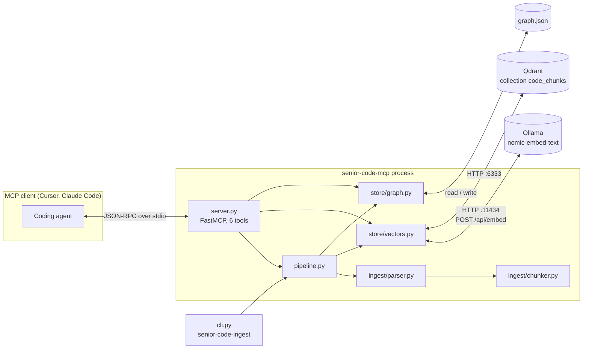
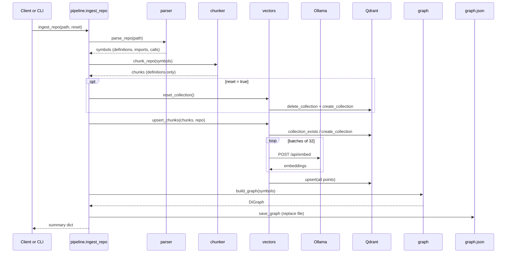
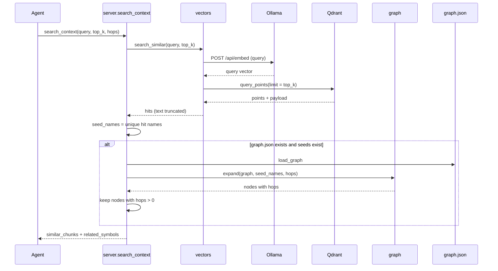
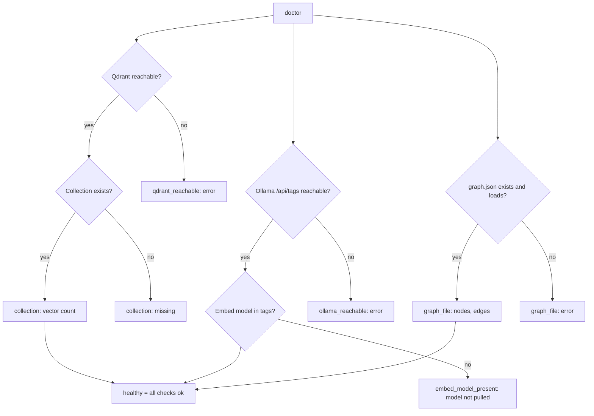
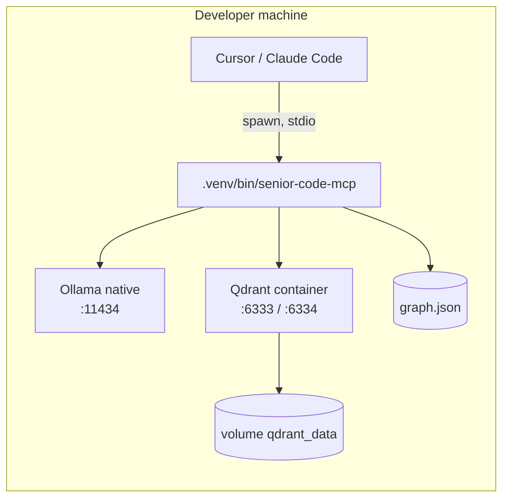

# Architecture

This document describes the design of Senior Code MCP at commit `0d3c27b`.
It covers the components, the runtime flows, the data model, the configuration, the evaluation harness and the known limits.
All statements come from the source code in `src/` and `eval/`.

## Contents

1. [System overview](#1-system-overview)
2. [Module map](#2-module-map)
3. [Module reference](#3-module-reference)
4. [Runtime flows](#4-runtime-flows)
5. [Data model](#5-data-model)
6. [Configuration](#6-configuration)
7. [Deployment topology](#7-deployment-topology)
8. [Evaluation harness](#8-evaluation-harness)
9. [Design decisions](#9-design-decisions)
10. [Performance characteristics](#10-performance-characteristics)
11. [Known limitations and extension points](#11-known-limitations-and-extension-points)

---

## 1. System overview

Senior Code MCP gives a coding agent two retrieval methods over Python, JavaScript, TypeScript/TSX, Go, Rust and Java repositories:

- **Semantic retrieval.** The server embeds each function, class and method with Ollama. Qdrant stores the vectors.
- **Structural retrieval.** The server builds a directed graph of call edges and import edges with NetworkX. A JSON file stores the graph.

An MCP client (Cursor, Claude Code or a different client) starts the server as a subprocess. The client and the server use JSON-RPC over stdio.



Two entry points share one ingest function:

| Entry point | Console script | Target |
| --- | --- | --- |
| MCP server | `senior-code-mcp` | `senior_code_mcp.server:main` |
| Ingest CLI | `senior-code-ingest` | `senior_code_mcp.cli:main` |

---

## 2. Module map

```
senior-code-mcp/
├── src/senior_code_mcp/
│   ├── __init__.py            # __version__ = "0.1.0"
│   ├── server.py              # FastMCP("senior-code-mcp"), stdio transport
│   │   ├── search_similar_code(query, top_k=5)
│   │   ├── search_related_code(names, hops=1)
│   │   ├── search_context(query, top_k=5, hops=1)
│   │   ├── ingest_repo(path, reset=False)
│   │   ├── store_stats()
│   │   ├── doctor()
│   │   └── main()             # mcp.run()
│   ├── cli.py                 # argparse: <path> [--reset], prints JSON summary
│   ├── pipeline.py            # GRAPH_PATH, ingest_repo(path, reset)
│   ├── ingest/
│   │   ├── parser.py          # Symbol dataclass, _visit (ast walk)
│   │   │   ├── parse_file(path, root=None) -> list[Symbol]
│   │   │   └── parse_repo(path) -> list[Symbol]
│   │   └── chunker.py         # Chunk dataclass
│   │       ├── chunk_symbol(sym) -> Chunk
│   │       ├── chunk_file(symbols) -> list[Chunk]
│   │       └── chunk_repo(symbols) -> list[Chunk]
│   └── store/
│       ├── vectors.py         # Ollama client + Qdrant client
│       │   ├── embed_texts(texts) -> list[list[float]]
│       │   ├── ensure_collection()
│       │   ├── upsert_chunks(chunks, repo=None)
│       │   ├── search_similar(query, top_k=5) -> list[dict]
│       │   ├── count_vectors() -> int
│       │   ├── reset_collection()
│       │   └── vector_size() -> int
│       └── graph.py           # NetworkX DiGraph
│           ├── build_graph(symbols) -> nx.DiGraph
│           ├── save_graph(graph, path)
│           ├── load_graph(path) -> nx.DiGraph
│           └── expand(graph, names, hops=1) -> list[dict]
├── eval/
│   ├── retrieval_ab.py        # Dense vs BM25 ablation, 12 gold queries
│   ├── coir_bench.py          # CoIR runner (BEIR-style encoder wrapper)
│   ├── cosqa_run.log          # Log of the cosqa run
│   └── results/
│       ├── cosqa.json         # NDCG@10, MAP, Recall for cosqa
│       └── retrieval_ab.txt   # Ablation output
├── AGENTS.md                  # Onboarding runbook for AI agents
├── FINALS.md                  # Hackathon demo playbook
├── docker-compose.yml         # qdrant + ollama services
├── .cursor/mcp.json           # Example client registration
├── pyproject.toml             # Dependencies, scripts, eval extra
└── graph.json                 # Generated graph (in .gitignore)
```

### Dependency direction

```mermaid
flowchart TD
    server --> pipeline
    server --> vectors
    server --> graph
    cli --> pipeline
    pipeline --> parser
    pipeline --> chunker
    pipeline --> vectors
    pipeline --> graph
    chunker --> parser
    vectors --> chunker
    graph --> parser
```

The modules do not have cycles. `parser.py` has no internal dependencies. It uses only the Python standard library.

---

## 3. Module reference

### 3.1 `server.py`

`server.py` creates one `FastMCP("senior-code-mcp")` instance. Each tool is a decorated function. `main()` calls `mcp.run()`, which uses the stdio transport.

| Tool | Parameters | Returns | Reads | Writes |
| --- | --- | --- | --- | --- |
| `search_similar_code` | `query: str`, `top_k: int = 5`, `language: str \| None = None` | List of hits: `score`, `id`, `repo`, `path`, `name`, `kind`, `language`, `start_line`, `end_line`, `docstring`, `text` | Ollama, Qdrant | Nothing |
| `search_related_code` | `names: list[str]`, `hops: int = 1` | List of nodes: `node`, `name`, `kind`, `path`, `start_line`, `end_line`, `hops`. Start nodes have `hops = 0`. | `graph.json` | Nothing |
| `search_context` | `query: str`, `top_k: int = 5`, `hops: int = 1`, `language: str \| None = None` | `query`, `seed_names`, `similar_chunks`, `related_symbols` | Ollama, Qdrant, `graph.json` | Nothing |
| `ingest_repo` | `path: str`, `reset: bool = False` | Ingest summary (refer to 3.2) | File system, Ollama | Qdrant, `graph.json` |
| `store_stats` | None | `collection`, `vector_count`, `graph_path`, `graph_nodes`, `graph_edges` | Qdrant, `graph.json` | Nothing |
| `doctor` | None | `healthy` and one entry for each check | Qdrant, Ollama, `graph.json` | Nothing |

Behavior details:

- `search_related_code` returns an error object if `graph.json` does not exist.
- `search_context` uses the unique `name` values of the vector hits as seeds. It removes the seeds from the graph result and keeps only nodes with `hops > 0`.
- `doctor` does five checks: `qdrant_reachable`, `collection`, `ollama_reachable`, `embed_model_present` and `graph_file`. `healthy` is true only if all five checks pass. The Ollama check compares model names without the tag (`nomic-embed-text:latest` becomes `nomic-embed-text`).
- `doctor` imports `httpx` inside the function and uses a 10-second timeout.

### 3.2 `pipeline.py`

`pipeline.py` holds the shared ingest function and the graph path.

- `GRAPH_PATH` comes from the environment variable `GRAPH_PATH`. The default is `<project root>/graph.json`. The project root is two levels above the package directory.
- `_repo_name(path)` returns the last component of the resolved path. This value goes into the `repo` field of each Qdrant point.

`ingest_repo(path, reset=False)` does these steps in sequence:

1. `parse_repo(path)` returns all symbols.
2. `chunk_repo(symbols)` returns the definition chunks.
3. If `reset` is true, `reset_collection()` deletes and creates the collection again.
4. `upsert_chunks(chunks, repo=repo)` embeds and stores the chunks.
5. `build_graph(symbols)` builds the graph from the symbols of this call only.
6. `save_graph(g, GRAPH_PATH)` writes the graph. This step replaces the previous file.

The function returns a summary with these keys: `path`, `repo`, `reset`, `symbols`, `chunks`, `collection`, `vector_size`, `vector_count`, `graph_nodes`, `graph_edges`, `graph_path`.

### 3.3 `cli.py`

`cli.py` parses `path` and the optional `--reset` flag with `argparse`. It calls `pipeline.ingest_repo` and prints the summary as indented JSON.

### 3.4 `ingest/parser.py`, `ingest/languages.py`, `ingest/treesitter.py`

`languages.py` holds one `LanguageSpec` for each language. A spec gives the file extensions, the grammar package and the node types for definitions, scopes, calls and imports. `detect_language` finds the spec from the file extension.

`parser.parse_file` selects the parser from the spec:

- Python: the standard library `ast` module (`_visit`).
- JavaScript, TypeScript, TSX, Go, Rust, Java: tree-sitter (`treesitter.parse_source`).

Both parsers emit a flat list of `Symbol` objects with the same fields.

**`Symbol` fields:**

| Field | Kinds | Content |
| --- | --- | --- |
| `name` | all | Definition name, callee text or module name |
| `kind` | all | `function`, `class`, `method`, `interface`, `struct`, `enum`, `trait`, `type`, `import` or `call` |
| `path` | all | File path relative to the repository root |
| `start_line`, `end_line` | all | 1-based line range |
| `source` | all | Source text of the line range |
| `docstring` | definitions | Python: value of `ast.get_docstring`. Other languages: the comments directly above the definition, without comment markers |
| `qualified` | definitions | Dotted name, for example `Class.method` or `outer.inner` |
| `enclosing` | calls | Qualified name of the enclosing definition, or `None` at module level |
| `callee` | calls | Text of the called expression from `ast.unparse`, for example `obj.method` |
| `module` | imports | Module of `from x import y`, or `None` for `import x` |
| `imported` | imports | Names that the statement imports (Python only) |
| `language` | all | `python`, `javascript`, `typescript`, `tsx`, `go`, `rust` or `java` |

**Walk rules (`_visit`):**

- A `FunctionDef` or an `AsyncFunctionDef` becomes a `method` if its parent is a class. Otherwise, it becomes a `function`.
- A `ClassDef` becomes a `class`.
- The walker keeps a stack of enclosing definitions. The stack gives the qualified name and the `enclosing` value of a call.
- An `Import` or an `ImportFrom` becomes an `import` symbol.
- A `Call` becomes a `call` symbol. The walker also visits the arguments of the call, so nested calls also become symbols.

**Tree-sitter walk rules (`treesitter.parse_source`):**

- The walk uses an explicit stack, not recursion.
- A function inside a class, interface, struct, trait, enum or Rust `impl` block becomes a `method`.
- A Rust `impl X` block and a `mod x` block add `X` or `x` to the qualified name. A Go method gets the receiver type as prefix, for example `MemoryRepo.Find`.
- JavaScript and TypeScript: `const f = () => ...` and `const f = function () {...}` become functions. `require("x")` becomes an import.
- The doc comment is the block of comments directly above the definition, or above its `export` statement. Rust attributes (`#[...]`) between the comment and the definition are allowed.
- A callee text longer than 120 characters is not recorded. A Rust macro call is recorded as `name!`.

**File walk rules (`parse_repo`):**

- The parser reads files with UTF-8 and replaces bytes that it cannot decode.
- If a file has a `SyntaxError`, the parser skips that file and returns no symbols for it.
- The parser skips these directory names: `.git`, `.hg`, `.svn`, `__pycache__`, `.venv`, `venv`, `env`, `.env`, `node_modules`, `.mypy_cache`, `.pytest_cache`, `.ruff_cache`, `dist`, `build`, `.eggs`, `.tox`, `site-packages`, `target`, `vendor`.
- The parser also skips each directory below the repository root that starts with a dot.
- The parser skips `*.min.*` files and files larger than 1 MB (`MAX_FILE_BYTES`).
- If `path` is one source file, the parser reads only that file.

### 3.5 `ingest/chunker.py`

The chunker keeps only definition symbols. Imports and calls do not become chunks. They exist only for graph edges.

| `Chunk` field | Source |
| --- | --- |
| `id` | `f"{path}:{start_line}:{end_line}:{name}"` |
| `path`, `name`, `kind` | Copied from the symbol |
| `start_line`, `end_line` | Copied from the symbol |
| `text` | The full source of the definition |
| `docstring` | Copied from the symbol |
| `language` | Copied from the symbol |

A class chunk contains the full class body, which includes its methods. Each method is also a separate chunk.

### 3.6 `store/vectors.py`

`vectors.py` holds the Ollama client and the Qdrant client.

**Embedding (`embed_texts`):**

- The function sends `POST {OLLAMA_URL}/api/embed` with `{"model": EMBED_MODEL, "input": [...]}`.
- It sends batches of 32 texts. The HTTP timeout is 120 seconds.
- The first response sets the module variable `_vector_size`. `vector_size()` sends a probe text if the size is not known.
- The live tools send the raw text without a task prefix.

**Collection (`ensure_collection`):**

- If the collection does not exist, the function creates it with `Distance.COSINE` and the detected vector size.

**Upsert (`upsert_chunks`):**

- The function embeds all chunk texts first. Then it sends all points to Qdrant in one `upsert` call.
- The point ID is `uuid5(NAMESPACE_URL, chunk.id)`. The same chunk always gets the same ID.

**Search (`search_similar`):**

- The function embeds the query and calls `query_points` with `limit=top_k`.
- `_truncate` cuts the returned `text` to 80 lines and 2,000 characters. It adds `…[truncated]` at the end. Qdrant keeps the full text.
- The search does not use a payload filter. Results can come from all ingested repositories.

**Other functions:**

- `count_vectors()` returns an exact count, or 0 if the collection does not exist.
- `reset_collection()` deletes the collection and creates it again.

### 3.7 `store/graph.py`

`graph.py` builds, saves, loads and searches a `networkx.DiGraph`.

**Node types:**

| Node type | Key | Attributes |
| --- | --- | --- |
| Definition | `qualified` name. If the key exists, the builder adds `@path:start_line`. | `name`, `kind`, `path`, `start_line`, `end_line`, `qualified` |
| File | `file:<path>` | `name` (base name), `kind = "file"`, `path` |
| Module | `module:<name>` | `name`, `kind = "module"` |

**Edge types:**

| Edge | From | To | Rule |
| --- | --- | --- | --- |
| `calls` | Enclosing definition | Callee definition | The builder looks up the enclosing definition by qualified name, then by last name segment. It looks up the callee by the last segment of the callee text and uses the first match. It does not add self edges. It does not add an edge if it cannot find both ends. |
| `imports` | File node | Module node | The builder adds module nodes for each `from` module and for each top-level `import x`. It adds an edge only to module nodes that exist. |

**Search (`expand`):**

1. `_resolve_starts` finds one start node for each name. It accepts a match on the qualified name, on the node name, or on the last segment of the given name. It takes the first match in node order.
2. A breadth-first search follows successors and predecessors. It treats the graph as undirected.
3. The search stops after `hops` levels.
4. The result has one entry for each node that the search found, with its hop distance. The start nodes have hop 0. The function sorts the result by hop, then by name.

**Persistence:**

- `save_graph` writes `nx.node_link_data(graph)` as indented JSON.
- `load_graph` reads the file with `nx.node_link_graph(data, directed=True)`.

---

## 4. Runtime flows

### 4.1 Ingest



### 4.2 `search_context`



### 4.3 `doctor`



---

## 5. Data model

### 5.1 Qdrant point

| Property | Value |
| --- | --- |
| Collection | `QDRANT_COLLECTION` (default `code_chunks`) |
| Distance | Cosine |
| Vector size | Detected from the first embedding (768 for `nomic-embed-text`) |
| Point ID | `uuid5(NAMESPACE_URL, "<path>:<start>:<end>:<name>")` |

Payload example:

```json
{
  "id": "backend/council.py:120:168:calculate_aggregate_rankings",
  "repo": "llm-council",
  "path": "backend/council.py",
  "name": "calculate_aggregate_rankings",
  "kind": "function",
  "start_line": 120,
  "end_line": 168,
  "text": "def calculate_aggregate_rankings(...):\n    ...",
  "docstring": "Aggregate peer rankings across models."
}
```

The values in this example are for illustration only.

### 5.2 `graph.json`

The file uses the NetworkX node-link format.

```json
{
  "directed": true,
  "multigraph": false,
  "nodes": [
    {"id": "Council.run", "name": "run", "kind": "method", "path": "backend/council.py",
     "start_line": 40, "end_line": 75, "qualified": "Council.run"},
    {"id": "file:backend/council.py", "name": "council.py", "kind": "file",
     "path": "backend/council.py"},
    {"id": "module:httpx", "name": "httpx", "kind": "module"}
  ],
  "edges": [
    {"source": "Council.run", "target": "calculate_aggregate_rankings", "kind": "calls"},
    {"source": "file:backend/council.py", "target": "module:httpx", "kind": "imports"}
  ]
}
```

The values in this example are for illustration only. NetworkX 3.6 writes the edge list under the key `edges`. Earlier versions use the key `links`.

---

## 6. Configuration

All modules read the environment variables one time, when Python imports the module. To change a value, restart the server.

| Variable | Default | Read in | Effect |
| --- | --- | --- | --- |
| `QDRANT_URL` | `http://localhost:6333` | `vectors.py` | Qdrant endpoint |
| `QDRANT_COLLECTION` | `code_chunks` | `vectors.py` | Collection name |
| `OLLAMA_URL` | `http://localhost:11434` | `vectors.py` | Ollama endpoint |
| `EMBED_MODEL` | `nomic-embed-text` | `vectors.py` | Embedding model |
| `GRAPH_PATH` | `<project root>/graph.json` | `pipeline.py` | Graph file location |

Runtime dependencies (`pyproject.toml`): `mcp`, `qdrant-client`, `networkx`, `httpx`, `tree-sitter` (`>=0.25.2,<0.26`), and the grammars `tree-sitter-python`, `tree-sitter-javascript`, `tree-sitter-typescript`, `tree-sitter-go`, `tree-sitter-rust`, `tree-sitter-java`. Python 3.13 or later is necessary.

The `eval` extra adds `coir-eval` and `numpy`.

---

## 7. Deployment topology

### 7.1 Local (default)



- On macOS, run Ollama natively. The native build uses the Metal GPU.
- `docker compose up` starts both services. `qdrant` exposes ports 6333 and 6334 with the volume `qdrant_data`. `ollama` exposes port 11434 with the volume `ollama_models`.
- Both images use the tag `latest`.

### 7.2 Client registration

`.cursor/mcp.json` shows the registration. The client starts the venv binary with no arguments:

```json
{
  "mcpServers": {
    "senior-code-mcp": {
      "command": "/absolute/path/to/.venv/bin/senior-code-mcp",
      "args": []
    }
  }
}
```

---

## 8. Evaluation harness

### 8.1 `eval/retrieval_ab.py`

This script compares the dense retrieval of the tool with a lexical baseline on the same corpus.

| Item | Value |
| --- | --- |
| Corpus | All payloads in the Qdrant collection, read with `scroll` (pages of 256) |
| Repositories | `llm-council` and `py-clean-arch`, in the parent directory of the repository |
| Gold set | 12 natural-language queries. Each query has one gold symbol and a path filter. |
| Dense arm | `vectors.search_similar(query, top_k=5)` |
| Lexical arm | BM25-Okapi in the script (`k1 = 1.5`, `b = 0.75`) over chunk tokens (`[A-Za-z0-9_]+`) |
| Quality metrics | Hit@1, Hit@3, MRR |
| Token metric | Dense: tokens of the 5 returned chunks. Lexical: tokens of the full files behind the top 3 BM25 hits, without duplicates. Tokens = characters / 4. |

Result on the stored corpus (394 chunks): Hit@1 58% vs 33%, Hit@3 75% vs 50%, MRR 0.688 vs 0.431, 1,099 vs 3,218 tokens for each query.

### 8.2 `eval/coir_bench.py`

This script runs CoIR tasks with the same Ollama embedding function.

- `OllamaNomicModel` gives the BEIR/CoIR interface `encode_queries` and `encode_corpus`.
- The wrapper adds the prefix `search_query: ` to queries and `search_document: ` to documents.
- The live MCP tools do not add these prefixes. Thus, the CoIR result measures the embedding model with prefixes, not the exact query path of the tools.
- Command: `uv run --extra eval python eval/coir_bench.py --task cosqa`.

---

## 9. Design decisions

| Decision | Reason | Cost |
| --- | --- | --- |
| Standard library `ast` for Python, tree-sitter for other languages | `ast` gives docstrings and exact structure for Python. Tree-sitter 0.26.0 caused segmentation faults on node access on CPython 3.13 on macOS arm64; 0.25.2 does not. | `tree-sitter` is pinned to `>=0.25.2,<0.26`. Two parsers to maintain. |
| One chunk for each definition | An agent can reuse a full function. A symbol chunk has fewer tokens than a full file. | The index does not contain module-level code outside definitions. |
| Deterministic point IDs | A second ingest replaces points. It does not add copies. | A moved function gets a new ID. The old point stays until a reset. |
| Graph in a JSON file | No graph database is necessary. A person can read the file. | The server loads the full file for each graph call. |
| Undirected neighborhood search | One call returns callers and callees. | The result does not show the direction of each edge. |
| Local services only | Code stays on the machine. | Embedding speed depends on local hardware. |

---

## 10. Performance characteristics

These points come from the code. We did not measure them.

- **Ingest memory.** `upsert_chunks` keeps all vectors in memory and sends one `upsert` request. Very large repositories can need much memory and a large request.
- **Ingest time.** Ollama embeds the chunks in sequential batches of 32. Embedding is the slowest step.
- **Graph load.** `search_related_code`, `search_context`, `store_stats` and `doctor` read and parse `graph.json` on each call. The server has no cache.
- **Start resolution.** `_resolve_starts` scans all nodes for each name. The cost is linear in the node count.
- **Search.** One query needs one embedding request and one Qdrant query.

---

## 11. Known limitations and extension points

| Limitation | Location | Possible change |
| --- | --- | --- |
| Each ingest replaces `graph.json`. The graph holds only the last repository. Qdrant holds all repositories. | `pipeline.ingest_repo` | Merge the new graph into the stored graph, or keep one graph file for each repository. |
| Vector search has no repository filter. | `vectors.search_similar` | Add a `repo` parameter and a Qdrant payload filter. |
| Call edges use the last name segment. The match is limited to the language family of the caller and prefers the same file. | `graph.build_graph` | Resolve callees through imports and the qualified names, or use a language server. |
| `ingest_repo` exposes `reset=True` to the agent. A reset deletes all repositories. | `server.ingest_repo` | Remove `reset` from the MCP tool. Keep it only in the CLI. |
| No incremental ingest. Each ingest embeds all chunks again. | `pipeline.ingest_repo` | Embed only chunks with a changed content hash. Delete points of removed files. |
| Seven languages only. | `ingest/languages.py` | Add a grammar package and one `LanguageSpec` entry for each new language. |
| The CoIR wrapper uses prefixes. The live tools do not. | `eval/coir_bench.py`, `vectors.embed_texts` | Add the same prefixes to the live path, then run the CoIR task again. |
| The Docker images use the tag `latest`. | `docker-compose.yml` | Pin the image versions. |
